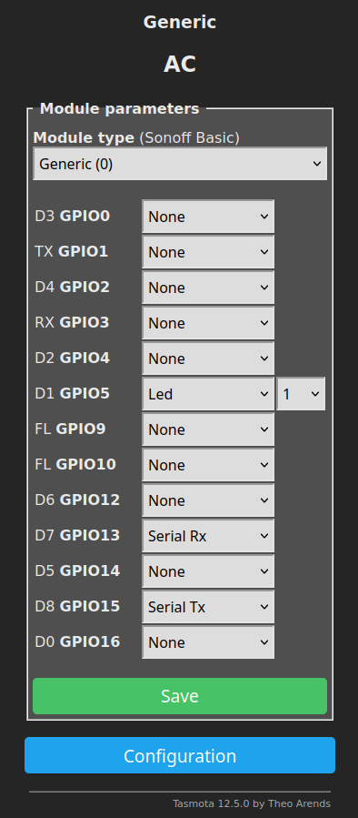

# Hacking AC Wifi Protocol

- Many ACs come with a Wifi module to connect them to the (chinese) cloud and control them from everywhere.
- Some makes are Kesser, but parts have TCL markings. I suppose a lot of other makes/rebrands have identical hardware.
- This is an approach to reverse engineer the protocol used for control from the cloud.
- I was successful to reassemble the whole functionality and liberating the AC from the cloud.

## The module

- Spare Part Number: 32001-000140
- [Tuya module](https://developer.tuya.com/en/docs/iot/wifie1smodule?id=K9605thnvg3e7)
- Connects to Tuya Cloud / Controlled via Tuya App
- It is connected via UART to the main board
- Brands using this module/protocol
  - Kesser
  - TCL
  - Pioneer
  - DAIZUKI
  - ... -> Tell me
- Pics
  - [Connector on the main board](doc/connector_main_board.jpg)
  - [Diagramm of main board](doc/diagramm_main_board.jpg)
  - [Wifi board top](doc/board_top.jpg)
  - [Wifi board bottom](doc/board_bottom.jpg)
  - [Housing](doc/module_in_housing.jpg)

## Physical layer

UART, 9600 baud, 8 data bits, even parity, 1 stop bit (**9600 8E1**).

The module also prints debug text on the same line, so a parser must resynchronise on the next `0xBB`.

## Frame format

| Offset | 0 | 1 | 2 | 3 | 4 | 5 … 5+L-1 | 5+L |
| :----- | :- | :- | :- | :- | :- | :-------- | :-- |
| **Field** | Preamble | Response flag | Request flag | Command | Payload length `L` | Payload | Checksum |
| **Value** | `0xBB` | `0x01` if sent by the AC, else `0x00` | `0x01` if sent by the module, else `0x00` | see below | | | XOR of all preceding bytes |

- Module -> AC frames start `BB 00 01`, AC -> module frames start `BB 01 00`.
- The checksum is the XOR of every preceding byte of the frame. There is no CRC.
- Maximum accepted payload length is `0xF9`.
- The response command id equals the request command id.
- Every AC response starts its payload with `0x04`.

Example: `BB 00 01 04 02 01 00 BD`

### Commands

| Cmd | Direction | Meaning | Request payload | Response payload |
| :-- | :-------- | :------ | :-------------- | :--------------- |
| `0x03` | module -> AC | Set values | 29 bytes | 55 bytes (state) |
| `0x04` | module -> AC | Get values | 2 bytes `01 00` | 55 bytes (state) |
| `0x05` | module -> AC | Set display | 9 bytes | 11 bytes |
| `0x06` | module -> AC | Acknowledge | 9 bytes | none |
| `0x09` | module -> AC | Diagnostics, status | 2 bytes `05 00` | 45 bytes |
| `0x0A` | module -> AC | Diagnostics, energy | 3 bytes `05 00 00` | 45 bytes |
| `0x0B` | module -> AC | Set date/time | 16 bytes | 2 bytes `04 00` |

**Notation below:** all field offsets are **payload** offsets. The frame offset is the payload offset + 5.
Bits are numbered LSB first, so `bit0` is `0x01`.

---

## 0x03: Set values

### Request — 29 byte payload

| Payload | Bits | Field | Values |
| :------ | :--- | :---- | :----- |
| `[2]` | 0 | reserved | 0 |
| `[2]` | 1 | reserved | 0 |
| `[2]` | 2 | Power | 1 = on, 0 = off |
| `[2]` | 3 | Off timer enable | 1 = armed |
| `[2]` | 4 | On timer enable | 1 = armed |
| `[2]` | 5 | Buzzer | 1 = on |
| `[2]` | 6 | Display | 1 = on |
| `[2]` | 7 | Eco mode | 1 = on |
| `[3]` | 0-3 | Mode | `1` heat, `2` dehumidify, `3` cool, `7` vent, `8` auto |
| `[3]` | 4 | Health | 1 = on |
| `[3]` | 6 | Turbo | 1 = on |
| `[3]` | 7 | Mute (low noise) | 1 = on |
| `[4]` | 0-3 | Target temperature | `0x0F + 16 - T`, T in 16..31 °C |
| `[5]` | 0-2 | Fan speed | `0` auto, `2` 1, `6` 2, `3` 3, `7` 4, `5` 5 |
| `[5]` | 3-5 | Vertical vane movement | `0b111` on, `0b000` off |
| `[6]` | 1 | Half degree | 1 = +0.5 °C |
| `[7]` | 3 | Horizontal vane movement | 1 = on |
| `[0x0E]` | 0-1 | Sleep mode | `0x00` off, `0x01` default, `0x02` old people?, `0x03` young people? |
| `[0x19]`, `[0x1A]` | | 8 °C heater mode | `0x60`, `0x01` |
| `[0x1B]` | 0-2, 3-5 | Vertical vane position | fixed / movement range |
| `[0x1C]` | 0-2, 3-5 | Horizontal vane position | fixed / movement range |

Example: `BB 00 01 03 1D 00 00 64 01 59 07 00 00 00 00 00 00 00 00 00 00 00 00 00 00 00 00 00 00 00 00 00 00 80 1F`

A set request is always a full snapshot: the current state is remapped into the payload and only the
changed fields are overwritten.

### Response — 55 byte payload

Identical to the `0x04` response, with command id `0x03`. The AC pushes one after every set command.

---

## 0x04: Get values

### Request — 2 byte payload

`01 00` -> `BB 00 01 04 02 01 00 BD`

### Response — 55 byte payload (state frame)

| Payload | Bits | Field | Values |
| :------ | :--- | :---- | :----- |
| `[0]` | | Marker | `0x04` |
| `[2]` | 0-3 | Mode | `1` cool, `2` vent, `3` dehumidify, `4` heat, `5` auto |
| `[2]` | 4 | Power | 1 = on |
| `[2]` | 4-7 | Status | `0x2` off, `0x3` on, `0x7` eco, `0xB` turbo |
| `[3]` | 0-3 | Target temperature | `T - 16` |
| `[3]` | 4-6 | Fan speed | `0` auto, `1` low, `2` mid, `3` high, `4` low-mid, `5` mid-high |
| `[4]` | 1 | Target temperature half degree | 1 = +0.5 °C |
| `[4]` | 6 | Off timer armed | 1 = armed |
| `[4]` | 7 | On timer armed | 1 = armed |
| `[5]` | 5 | Horizontal swing | 1 = moving |
| `[5]` | 6 | Vertical swing | 1 = moving |
| `[6]`, `[7]` | | Off timer | hours, minutes (binary, 30 minute steps) |
| `[8]`, `[9]` | | On timer | hours, minutes (binary, 30 minute steps) |
| `[0x0A]` | 7 | Ack request | 1 = AC expects a `0x06` |
| `[0x0C]`, `[0x0D]` | | Room temperature | `T = (b[0x0C] * 4 + ((b[0x0D] >> 2) & 3) - 200) / 10` °C |
| `[0x19]` | | Outlet temperature | `T = (b[0x19] * 4 - 200) / 10` °C |
| `[0x1D]` | | Indoor unit active | `0x00` only while the unit is off |
| `[0x21]` | 7 | Mute | 1 = on |
| `[0x22]` | | Compressor active | `0x30` cooling, `0x2C` heating, `0x00` off |
| `[0x2E]` | 0-2, 3-4 | Vertical vane | fixed position, movement range |
| `[0x2F]` | 0-2, 3-5 | Horizontal vane | fixed position, movement range |

Example: `BB 01 00 03 37 04 00 34 D6 00 00 00 00 00 00 00 00 73 03 88 00 00 00 00 00 00 00 00 00 00 91 FF 40 00 6C 1F 1B 4F 52 18 CA 00 00 00 00 E0 01 00 00 44 40 00 00 00 00 1A 00 00 00 00 E6`

#### Timers

The timers are armed from the IR remote. Values are plain binary, not BCD, and step in 30 minute
increments (`[6] = 1, [7] = 0` -> 1 h 00; `[7] = 0x1E` -> 1 h 30; `[6] = 2, [7] = 0` -> 2 h 00).
Cancelling clears both the enable bit and the value bytes. Both timers can be armed at the same time.

#### Unmapped bytes

Never observed non-zero: `[0x01]`, `[0x0B]`, `[0x0F]`-`[0x18]`, `[0x24]`-`[0x27]`, `[0x33]`-`[0x36]`.

Observed non-zero, meaning unknown: `[0x0E]`, `[0x1A]` (`0xFF`), `[0x1E]`, `[0x1F]`, `[0x20]`, `[0x28]`.

`[0x0D] bit5` selects between two values in `[0x19]`: the bit and the byte always change together
(69 of 69 observations, neither ever alone) and the two values vary independently of each other, so it
is not a fixed offset. What the second value is, is unknown.

Partially mapped: `[0x04]`, `[0x05]`, `[0x1B]`, `[0x1C]`, `[0x2B]`, `[0x2C]`, `[0x2D]`, `[0x30]`,
`[0x31]`, `[0x32]`.

---

## 0x05: Set display

### Request — 9 byte payload

`00 00 00 00 00 00 00 00 <code>`, code = `1` (AP), `2` (SA), `4` (PP), `8` (CF).

Example: `BB 00 01 05 09 00 00 00 00 00 00 00 00 01 B7`

### Response — 11 byte payload

`04 00 00 00 00 00 00 00 00 00 <code>`

Example: `BB 01 00 05 0B 04 00 00 00 00 00 00 00 00 00 01 B1`

---

## 0x06: Acknowledge

Sent when the state frame has `[0x0A] bit7` set. 9 byte payload, all zero except `[8] = 0x80`.
The AC sends no response. The bit has not been observed set on a Kesser/TCL indoor unit.

Example: `BB 00 01 06 09 00 00 00 00 00 00 00 00 80 35`

---

## 0x09: Diagnostics, status

### Request — 2 byte payload

`05 00` -> `BB 00 01 09 02 05 00 B4`

### Response — 45 byte payload

Example: `BB 01 00 09 2D 04 00 00 00 00 00 00 FF 00 00 00 00 00 FF FF 00 00 00 00 00 00 F0 FF 00 00 00 00 00 00 00 00 00 00 00 00 00 00 00 00 00 00 00 00 00 00 6A`

Only `[0]` (`0x04` marker) is mapped. `[0x07]`, `[0x0D]`, `[0x0E]`, `[0x16]` are `0xFF` and `[0x15]` is
`0xF0`; all other bytes have been zero in every capture.

---

## 0x0A: Diagnostics, energy

### Request — 3 byte payload

`05 00 00` -> `BB 00 01 0A 03 05 00 00 B6`

A variant with `05 00 08` is also accepted and answered identically.

### Response — 45 byte payload

| Payload | Field |
| :------ | :---- |
| `[0]` | Marker `0x04` |
| `[2]` | `0x04` = no data in this reply, `0x0C` = counters present |
| `[3]`, `[0x10]`, `[0x0F]` | Energy, fractional part, packed BCD, most significant pair first |
| `[6]`, `[5]`, `[4]` | Energy, integer part in kWh, packed BCD, most significant pair first |
| `[0x11]`, `[0x12]` | Tick counter, u16 little endian, +1 per ~2 minutes while powered on |

```
bcd(v)   = (v >> 4) * 10 + (v & 0x0F)
fraction = bcd(b[3]) * 10000 + bcd(b[0x10]) * 100 + bcd(b[0x0F])     # 1e-6 kWh
integer  = bcd(b[6]) * 10000 + bcd(b[5])    * 100 + bcd(b[4])        # kWh
total    = integer + fraction / 1e6                                   # kWh
```

The counter meters the compressor / outdoor unit only. It does not advance in fan-only operation, and
during a cooling run it accumulated about 2 Wh per 2 minute tick less than a meter on the mains inlet.

Example, no data: `BB 01 00 0A 2D 04 00 04 00 00 00 00 00 00 00 00 00 00 00 00 00 00 00 00 00 00 00 00 00 00 00 00 00 00 00 00 00 00 00 00 00 00 00 00 00 00 00 00 00 00 9D`

Example, 1.194875 kWh: `BB 01 00 0A 2D 04 00 0C 19 01 00 00 00 00 00 00 00 00 00 00 75 48 73 04 00 00 00 00 00 00 00 00 00 00 00 00 00 00 00 00 00 00 00 00 00 00 00 00 00 00 C7`

### Getting an answer to 0x09 / 0x0A

The AC only answers when the poll is chained onto a completed get exchange and the line is otherwise
idle:

```
TX 0x04 GET
RX 0x04 state          (after ~215 ms)
TX 0x0A                (~180 ms after the state response)
RX 0x0A                (after ~215 ms)
TX 0x09                (~190 ms after the 0x0A response)
RX 0x09
                       line idle, next get after ~3 s
```

A free running poll that is not chained to a state response is never answered. A running compressor is
not required.

---

## 0x0B: Set date/time

### Request — 16 byte payload

| Payload | Field |
| :------ | :---- |
| `[0]` | `0x05` |
| `[1]` | `0x00` |
| `[2]`, `[3]` | Year, u16 little endian |
| `[4]` | Month, 1-12 |
| `[5]` | Day of month |
| `[6]` | Hour |
| `[7]` | Minute |
| `[8]` | Second |
| `[9]`-`[15]` | `0x00` |

Example, 2026-08-10 14:23:05: `BB 00 01 0B 10 05 00 EA 07 08 0A 0E 17 05 00 00 00 00 00 00 00 57`

### Response — 2 byte payload

`04 00` -> `BB 01 00 0B 02 04 00 B7`

The AC acknowledges the frame within about a second.

---

## Traffic

- Get: on link up and after a power state change; the original module repeats it about every 3 s.
- Set: whenever a setting changes.
- Display: whenever the display state changes.
- Diagnostics pair `0x0A` then `0x09`: chained to a get exchange, every few polls.
- Date/time: whenever the clock is pushed.
- Frames with a wrong checksum are dropped and the parser resynchronises on the next `0xBB`.

## Adding to home automation

### ESPHome

https://gitlab.com/adaasch/ac-esphome

### Using [Tasmota](https://github.com/arendst/Tasmota)
  - Console:
    - Deactivate Tasmota log on serial port: `SerialLog 0`
    - Config serial port: `SerialConfig 8E1`, `Baudrate 9600`
  - 
- [MQTT Bridge](ac_control.py)
